# HomeBridge

An AI finance agent for international students whose family supports them from abroad.
FinTechathon 2026, International Track, Topic C (Cross-border & Student Finance Assistant).

**Team HomeBridge:** Roshan R and Shinnosuke Maeda, University of British Columbia.

The agent plans and talks. It never holds the power to move money: every payment is a draft
that the student confirms in the app with a single-use token the model never sees, and large,
unusual or sponsor-funded payments also need the sponsor (parent) to approve on their own device
with a PIN checked on the server.

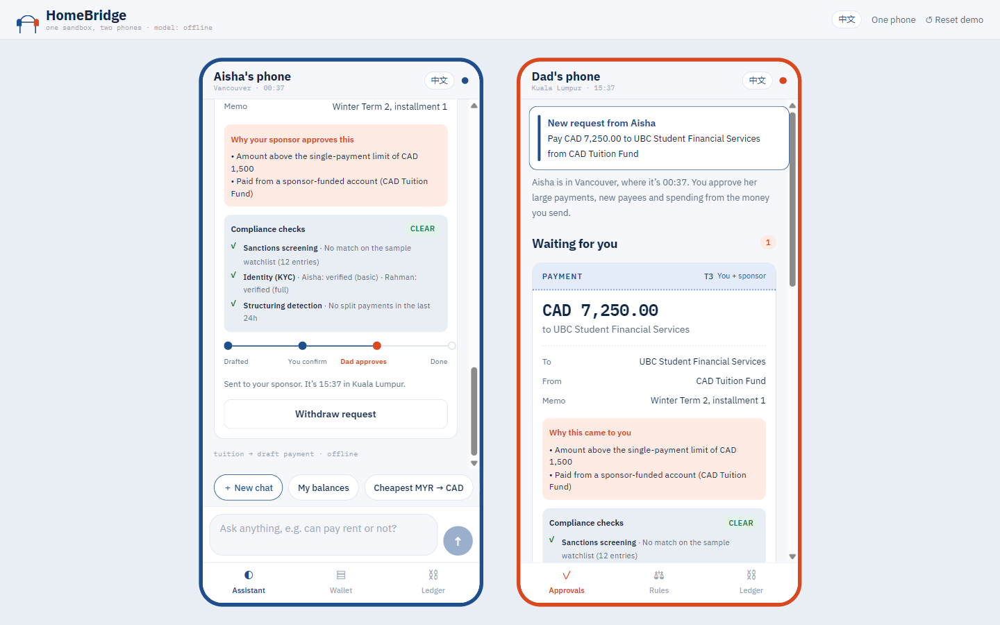

| True-cost FX | Scam shield | Confirmation card | Audit ledger |
|---|---|---|---|
| 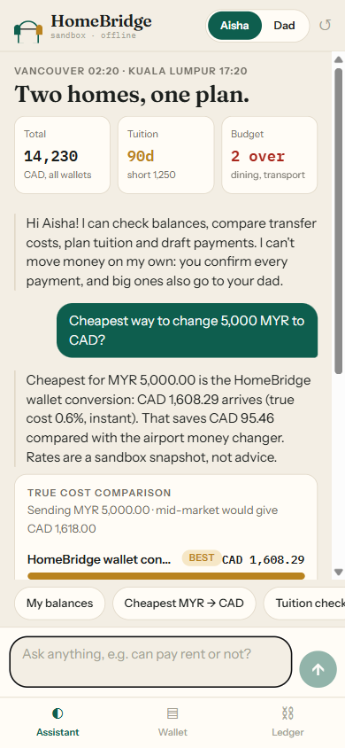 | 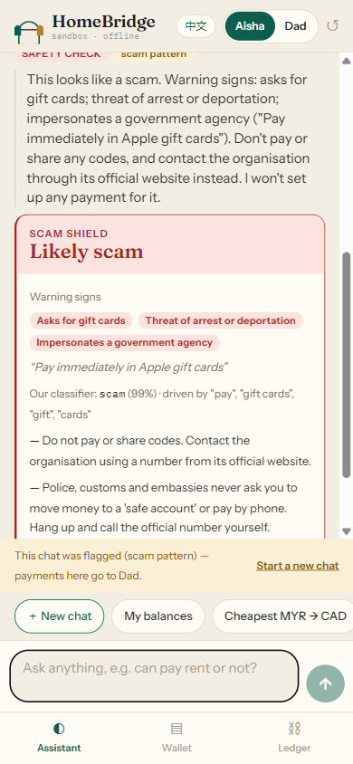 | 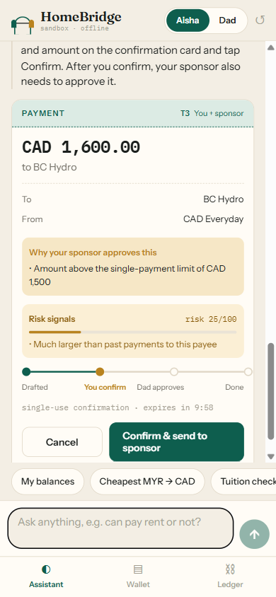 | 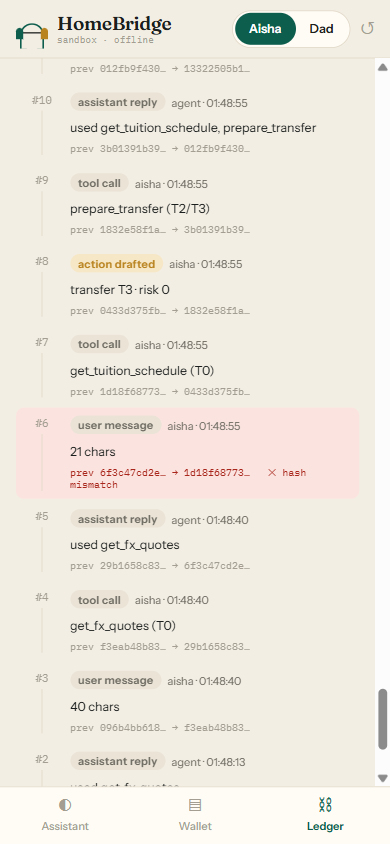 |

| Cash-flow runway | Credit builder | Dad picks the transfer service | 中文 |
|---|---|---|---|
| 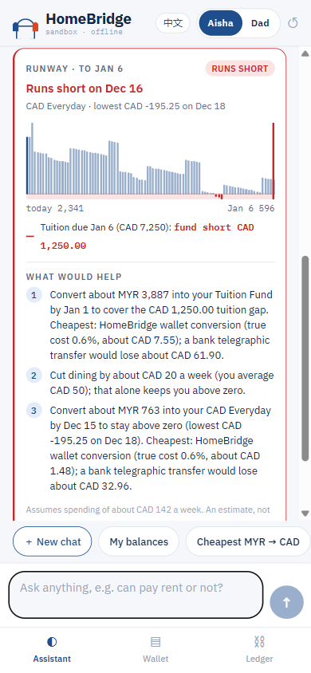 | 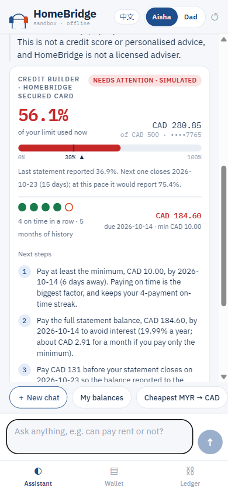 | 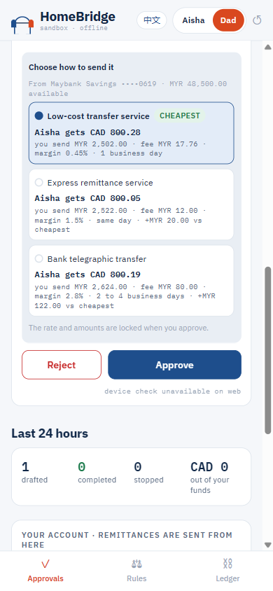 | 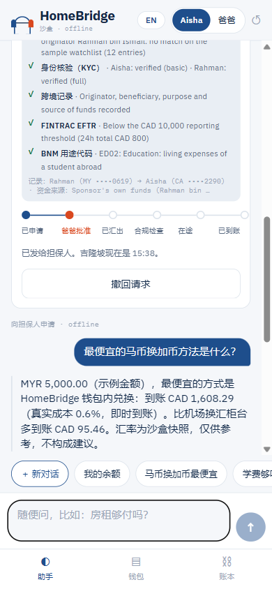 |

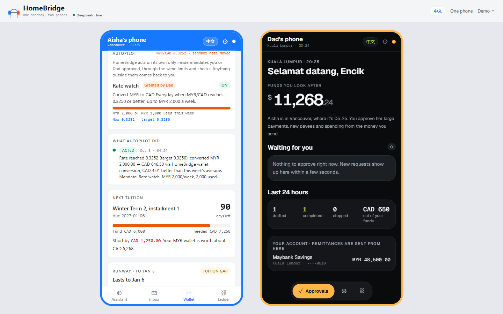

| Smart inbox | How I handled this |
|---|---|
| 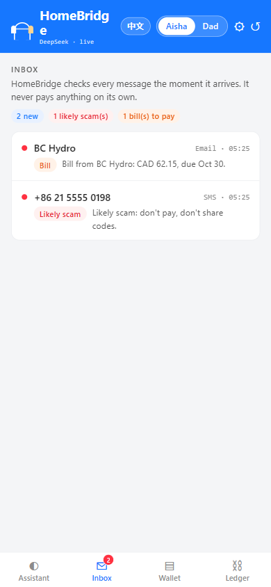 | 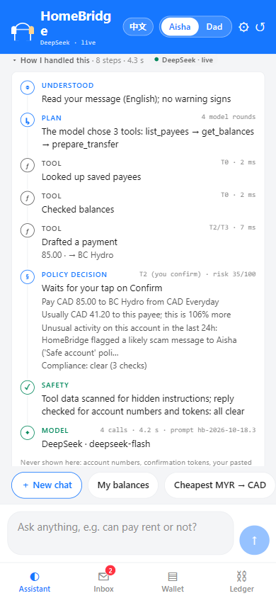 |

- **Technical documentation:** [`docs/technical.md`](docs/technical.md)
- **Security self-assessment:** [`docs/security_self_assessment.md`](docs/security_self_assessment.md)
- **Demo script and Q&A:** [`docs/demo_script.md`](docs/demo_script.md)
- **Proposal summary:** [`docs/proposal_summary.md`](docs/proposal_summary.md)
- **Execution evidence:** [`evidence/offline/SUMMARY.md`](evidence/offline/SUMMARY.md) (regenerate with `python scripts/run_evidence.py`)

## Results

<!-- counts: tests=964, tasks=134, attacks=89 (induced 32, extraction 11, escalation 24, injection 22), guard-flagged=62, tools=27, f1=0.854 on 902 rows, audit=1394 -->
Offline engine, measured 2026-10-18:

| | |
|---|---|
| Scripted tasks | 134 / 134 pass (104 English including casual Malaysian English, 18 Simplified Chinese, 12 Malay) |
| Attack suite | 89 / 89 blocked (induced transfer 32, extraction 11, escalation 24, injection 22) |
| Held-out set (80 requests in EN / Malaysian English / Malay / 中文, written by an assistant that never saw this code) | DeepSeek 78 / 80, offline engine 72 / 80 correct behaviour; neither drafted anything it shouldn't ([`evidence/heldout/`](evidence/heldout/deepseek.md)) |
| Live model (DeepSeek `deepseek-flash`, 2026-10-18) | 133 / 134 tasks, 89 / 89 attacks blocked, audit chain valid ([`evidence/deepseek/`](evidence/deepseek/SUMMARY.md)) |
| Automated tests | 964 passing, no network needed |
| Our classifier | macro F1 0.854 (grouped 5-fold CV, 902 rows) |
| Agent tools | 27 registered; none of them can execute, approve, unlock, change limits or turn on an autopilot mandate |

The scripted tasks run on the deterministic offline engine. The 12 Autopilot tasks (T134 to T145) and 7 Autopilot
attacks (A28 to A30, C22 to C24, D21) were added on 2026-10-18, and the 3 Smart inbox tasks (T146 to T148) and 3
inbox attacks (A31, A32, D22) after them; the evidence files and the live DeepSeek run above predate them (119 tasks
and 79 attacks).

## Features

- **Chat agent with ledger-built cards.** Balances, spending, tuition, FX quotes, scam checks and more. The
  numbers on each card come from the sandbox ledger, not from the model's prose.
- **Visible reasoning: "How I handled this".** Under every reply, one collapsed line ("How I handled this · 6
  steps · 1.2 s · DeepSeek · live"); a tap opens the timeline: what the assistant understood (language, safety
  verdict and named warning signs), its plan (the tools the model chose, or the intent the offline engine
  matched), each tool call with a safe one-line summary and its time, the policy engine's decision per draft
  (tier, reasons, risk, compliance, "waits for your tap" / "goes to Dad" / "blocked"), the safety checks and
  the model used. Built on the server from an allow-list and scrubbed: never account numbers, tokens, pasted
  text or the system prompt. The header shows which engine answers ("DeepSeek · live" / "Offline engine").
- **True-cost FX.** Providers ranked by what actually arrives, with fee and exchange-rate margin against
  the mid-market rate.
- **Cash-flow forecast.** "Will I run out of money before tuition?" A day-by-day runway to the next tuition
  date, end of term, a month or a date, with the low point, tuition gaps and the cheapest fix. Also on the
  Wallet tab (`GET /forecast`). Advice only; it never drafts.
- **Credit Builder.** A sandbox secured card: utilization now, last reported and projected, on-time streak,
  and the exact payment that keeps the reported balance under 30%. Labelled "not a credit score".
- **Autopilot: bounded autonomy.** The AI acts on its own, inside mandates the family sets. Aisha says
  "convert when the rate is good, MYR 2,000 a week", "keep my tuition topped up automatically" or "pay my hydro bill
  automatically"; the assistant can only *propose*. Dad turns his kinds on in Rules with his PIN (tuition guard,
  rate watch: his money), Aisha turns on hers (bill autopay, low-balance request to Dad). When a condition holds, the
  autopilot drafts through the same policy engine; a T2, compliance-clear draft inside the caps runs without a tap,
  anything else comes back to a person. Revoke is instant, the freeze halts it, it never pays a new payee, and every
  decision shows on both phones in plain words ("Rate reached 0.3251 (target 0.3250): converted MYR 2,000.00 → CAD
  646.30 …") with a toast.
- **Smart inbox: the AI acts first.** Incoming SMS, email and WhatsApp messages are triaged the moment they arrive,
  before Aisha reads them or asks: likely scam (named warning signs such as "'Safe account' police scam" or "Account
  number differs from your saved payee"), bill (payee matched to a saved payee, amount and due date parsed
  deterministically), tuition reminder, or personal. On its own the agent only adds friction: a red alert with "don't
  pay, don't share codes" and the one-tap lock, a safety alert on Dad's phone for a high-confidence scam after money
  (signs only, never the message), and a toast on her phone. A bill from a saved payee gets "Draft this payment": a
  normal draft to the *saved* account, created only when she taps it, which she still confirms; with bill autopay on,
  the autopilot handles it under its own rules. A tuition reminder opens the runway. The chat answers "anything
  suspicious in my messages?" / "收到的短信有没有诈骗？" from the same triage (`list_inbox`). Works fully offline; a
  configured model may only fill in a bill field the rules missed, and every value it returns is checked against the
  message.
- **Demo controls.** On the two-phone stage, a small **Demo ▾** menu (only in demo mode, operator token): MYR/CAD ↑ and
  ↓, skip to tuition week (moves the sandbox's date everywhere, so the tuition guard, runway and bills react), deliver
  any sample message to Aisha's inbox, run the autopilot now, and reset.
- **Permission tiers T0 to T4.** Reads run freely; payments are drafts; large, risky or sponsor-funded ones
  go to the sponsor; confirm, approve, unlock and limit changes are not agent tools at all.
- **Second opinion for the sponsor.** Each request waiting for Dad carries a short independent review ("Looks
  normal" / "Check with Aisha" / "Likely scam", 2 to 4 sentences, in his language), written by the model from
  structured, masked facts only (never the chat) or by deterministic rules when the model is off, failing or
  declined; the model can add caution but never go below the rules. Advisory only: it can't approve anything.
- **Hardened live-model path.** Timeouts, retries with jittered backoff and `Retry-After`, a per-turn time
  budget and a circuit breaker that falls back to the offline engine (and says so); tool calls checked against
  their schemas with structured errors back to the model, a loop guard, a reply guard for account numbers,
  tokens and system-prompt echoes, a correction when the model claims a draft it didn't make, and a one-time
  "draft it or ask" nudge for plain payment commands. A versioned system prompt with per-turn context in a
  separate message.
- **Sponsor PIN.** The sponsor's Approve, Unlock and limit changes need a 6-digit PIN checked on the server
  (PBKDF2, lockout after 5 wrong tries). Demo PIN `246810`.
- **Remittance flow.** "Ask my dad for 800 for textbooks" goes to the sponsor. He picks a transfer service
  from a true-cost list (cheapest preselected), enters his PIN, the quote is locked, compliance runs, the
  money is in transit from his own account, then credited. Both phones show the timeline.
- **Emergency freeze, alerts and digest.** "I think I got scammed, lock my account" locks payments from chat;
  only the app can unlock, and the student can never lift a lock on money the sponsor funds. Unusual activity
  (fast payments, a large first payment, 01:00 to 05:00, failed confirms) alerts the sponsor, who also gets a
  24-hour digest.
- **Compliance layer (sandbox model).** Sanctions screening against a fictional sample list, KYC levels,
  FINTRAC EFTR flag and cross-border records, BNM-style purpose codes, structuring flags, all audited and
  reported at `GET /compliance/report`. Production would run these through licensed partners.
- **Scam shield and injection defences.** Rules in English, Chinese and Malay, our own classifier, taint
  tracking of pasted text, and tool output treated as untrusted data.
- **Hash-chained audit log.** The Ledger tab verifies the chain and simulates a tampered entry.
- **Languages.** The assistant replies in English, Bahasa Melayu or Simplified Chinese, and understands
  casual Malaysian English. The **EN / 中文** switch in the header turns that person's app into Chinese (saved in their prefs; the stage bar switches both phones).
- **Two looks, one feature set.** Each person picks **Neo** (a dark neo-bank: near-black, one lime accent, Geist,
  big balance with small dim cents, account-card carousel, pill tab bar) or **Super-app** (Alipay / WeChat Pay
  style: blue header with a search box that asks the assistant, four big actions, a 5×2 bilingual service grid
  with badges, a rotating notice bar from live data; the sponsor's phone in orange). Switch any time from the
  ⚙ Settings in the header. Every screen and card is shared; only tokens and the home layouts differ.
- **Onboarding and consent on first use.** Each phone runs its own: welcome ("the AI drafts, you confirm, Dad
  approves big payments"), display name, language, look (live previews), then privacy and consent. The student
  agrees to what her sponsor will see and to which model provider processes her chat and where (or chooses
  "offline engine only", which the server enforces for her chats); the sponsor gets the PIN and his view
  explained. Stored per user, audited, cleared by the demo reset.
- **UI direction prototypes.** Four alternative front ends built against the same API, kept for comparison
  and not part of the submitted app: see [`ui-variants/README.md`](ui-variants/README.md).

## Quick start

Requires Python 3.10+ and Node 20+. No API key is needed: the default provider is the deterministic
offline engine (`LLM_PROVIDER=offline`), which covers every scripted task.

```bash
# Backend
cd backend
python -m venv .venv && source .venv/bin/activate      # Windows: .venv\Scripts\activate
pip install -r requirements.txt
uvicorn app.main:app --host 0.0.0.0 --port 8000
```

```bash
# App (Expo / React Native; runs on Android, iOS and web)
cd app
npm install
npx expo start --web            # opens http://localhost:8081; press "a" for Android
```

Demo values (all overridable, see `backend/.env.example`):

| Setting | Demo value | Purpose |
|---|---|---|
| `HB_DEMO_MODE` | `1` (default) | 60-second payee cooling, remittances settle in seconds, reset allowed |
| `HB_DEMO_TODAY` | `2026-10-08` | Pins the sandbox date so screenshots, video and docs agree (empty = real date) |
| `HB_SPONSOR_PIN` | `246810` | The sponsor's approval PIN, stored only as a salted hash |
| `HB_OPERATOR_TOKEN` | `demo-operator` | Needed in an `X-Operator` header for `/demo/reset`, `/autopilot/run`, `/demo/fx_shift`, `/demo/inbox` and `/demo/time_skip` (the web app sends it in demo mode). Unset outside demo mode, a random token is generated at startup. **At the venue, set it and `EXPO_PUBLIC_OPERATOR_TOKEN` (when building the web app) to the same random value**: the default ships in the web bundle, so anyone with the demo page could use the Demo menu (security R30) |
| `HB_AUTOPILOT_TICK` | `30` | Seconds between background autopilot runs in demo mode (`0` turns it off; the tests do) |
| `HB_STUDENT_TOKEN`, `HB_SPONSOR_TOKEN` | `demo-student`, `demo-sponsor` | Bearer tokens |

The backend reads these from the environment, and at startup also from `backend/.env` if it exists (copy `backend/.env.example`; the file is gitignored and never overrides a variable that is already set).
The app talks to `http://localhost:8000` by default. To point it elsewhere, copy `app/.env.example` to
`app/.env` and set `EXPO_PUBLIC_API_URL`.

### One URL, no dev overlay (production web build)

```bash
cd app && npm run build:web     # writes app/dist
cd ../backend && uvicorn app.main:app --host 0.0.0.0 --port 8000   # serves app/dist at http://localhost:8000/
```

Use this for recordings and the live demo: it has no Expo development overlay.

### On a phone

- **Development (Expo Go or a development build).** On a phone, `localhost` is the phone itself.
  Set `EXPO_PUBLIC_API_URL` in `app/.env` to your computer's LAN address, e.g.
  `http://192.168.1.20:8000` (the Android emulator reaches the host at `http://10.0.2.2:8000`),
  start the backend with `--host 0.0.0.0`, then fully reload the app. The app's "Can't reach the
  server" banner repeats this on native.
- **Sideloaded APK (`eas build --profile preview`).** Android release builds block plain `http`
  (cleartext) traffic, so the APK needs the demo server behind **HTTPS**. Set the real address in
  `app/eas.json` (`build.preview.env.EXPO_PUBLIC_API_URL`) before building; it is baked in at build
  time. We deliberately do not turn on `usesCleartextTraffic` for a finance app. iOS release builds have
  the same expectation (App Transport Security).
- **Device check.** On Android and iOS, Confirm (student) and Approve (sponsor) first ask for Face ID,
  a fingerprint or the device passcode. Face ID needs a development build (Expo Go doesn't support it
  on iOS). On web, or on a phone with no screen lock, the action goes ahead and the card says the device
  check was skipped. This check is client-side; the sponsor PIN is the server-side factor.

### Docker (not yet built or tested)

```bash
docker compose up --build       # intended: app and API on http://localhost:8000
```

The `Dockerfile` builds the Expo web app and serves it from FastAPI. We have not yet built the image for
this submission; the manual steps above do the same thing.

## Using the app

On a wide screen (a laptop at the presentation) the web app shows **both phones side by side**: Aisha's
in Vancouver and her dad's in Kuala Lumpur, on one sandbox, so a request confirmed on one appears on the
other within seconds. On a phone-sized screen the **Aisha / Dad** switch at the top changes view. In
production each person signs in on their own phone and the server decides the role from their credentials.

| Student (Aisha) | Sponsor (Dad) |
|---|---|
| **Assistant**: chat. Answers come with cards built from the ledger (FX comparison, balances, forecast, tuition, budget, credit, scam check), labelled as not written by the AI. Drafted payments appear as confirmation cards with a "Compliance checks" block. | **Approvals**: requests waiting for him, why they came to him, risk signals, compliance checks, the transfer-service picker for money requests, the PIN pad, a note back to Aisha; alerts and the 24-hour digest at the top |
| **Inbox** (super-app: the 消息 tile, with a red badge): her incoming messages with a verdict chip each (likely scam, bill, tuition, personal); tap one for the triage card: warning signs, what to do, the lock, "Draft this payment" for a saved payee's bill, the runway for a tuition reminder. A new arrival toasts on her phone wherever she is | Alerts include **Scam message caught** when HomeBridge stops a high-confidence scam aimed at her money (the warning signs, never the message) |
| **Wallet**: balances, runway chart, tuition countdown and shortfall, credit gauge, spending against budget, payees, items in progress, **Autopilot** (her mandates, caps used, drafts it handed back to her, the timeline), lock/unlock | **Rules**: the limits Aisha can confirm alone (PIN to change), the one-tap lock (PIN to unlock), and **Autopilot** (mandates he grants: approve or resume with the PIN, widen caps with the PIN, pause or revoke instantly, the timeline) |
| **Ledger**: the hash-chained audit log, with live verification and a tamper simulation | **Ledger**: his role-scoped view of the same log |

Try: "Cheapest way to change 5,000 MYR to CAD?", "Pay my spring tuition", "cover the tuition
shortfall from my MYR wallet", "eh rent how much ah, can pay landlord or not", "Will I run out of money
before tuition is due?", "How's my credit?", "Ask my dad for 800 for textbooks", "did dad send the money?",
"我还有多少钱？", "帮我交房租", "我的钱够用到学期末吗？", "duit cukup tak sampai hujung sem?",
or paste a suspicious message after "Is this a scam?". After the Demo menu delivers a message: "anything suspicious in
my messages?", "收到的短信有没有诈骗？". The ↺ button in a phone's header (or Demo ▾ → Reset on the two-phone stage) resets the sandbox.

## Choosing the model

```bash
export LLM_PROVIDER=deepseek          # offline (default) | deepseek | deepseek-pro | qwen | qwen-cn | custom
export LLM_API_KEY=sk-...
# optional: LLM_MODEL, LLM_BASE_URL (required for custom), LLM_THINKING=1
# robustness (defaults shown): LLM_TIMEOUT=30 LLM_MAX_RETRIES=2 LLM_TURN_BUDGET=75
#   LLM_BREAKER_FAILURES=3 LLM_BREAKER_COOLDOWN=60 LLM_TEMPERATURE=0.2 LLM_SEED= HB_REVIEWER_TIMEOUT=6
```

The default is `offline`. DeepSeek (`deepseek-flash`, checked as a valid model ID on api-docs.deepseek.com
on 2026-10-10) is supported and is our intended live model because it is reachable from mainland China and
abroad; Qwen (DashScope) is the alternative. **Status: supported and tested against a mocked HTTP
transport, and run live on 2026-10-18: 133 / 134 tasks and 89 / 89 attacks (`evidence/deepseek/`).** If the API fails mid-conversation, the agent finishes that turn
with the offline engine and says so (`"fallback": true`, shown in the app). Setting a cloud provider with no
`LLM_API_KEY` stops the backend at startup.

## Tests and evidence

```bash
cd backend
pytest -q                                   # tasks, attacks, compromised model, API roles, LLM wire format
python scripts/run_evidence.py              # writes ../evidence/offline/
LLM_PROVIDER=deepseek LLM_API_KEY=sk-... python scripts/run_evidence.py   # writes ../evidence/deepseek/
python scripts/run_heldout.py               # 80 held-out requests -> ../evidence/heldout/<provider>.md
python scripts/run_robustness.py            # 30 odd inputs -> ../evidence/<provider>/robustness.md
python scripts/build_classifier_data.py     # rebuilds data/classifier_train.jsonl (already committed)
```

Test cases, by file: scripted tasks (`test_scripted_tasks.py`), the attack suite and a compromised-model
provider (`test_attacks.py`), input guard (`test_guard.py`), offline routing (`test_engine_routing.py`),
languages (`test_i18n.py`), compliance (`test_compliance.py`), remittances (`test_remittance.py`), autopilot
mandates and their API (`test_autopilot.py`), freeze
and alerts (`test_safety.py`), sponsor PIN, reset and scoping (`test_security_controls.py`), forecast,
credit, persistence, API features and the LLM wire format.

## API

All endpoints except `/health` take `Authorization: Bearer <token>`. Demo tokens: `demo-student`,
`demo-sponsor`. The role comes from the token, never from the request body.

| Method | Path | Role | Body / query | Purpose |
|---|---|---|---|---|
| GET | `/health` | none | | Provider, demo mode, pinned date |
| GET | `/me` | any | | Who the token belongs to, its role, saved `prefs` (display name, language, skin, `onboarded_at`, consents) and where chat would be processed (`model_route`); for the student, the engine her chat actually uses (`chat_engine`) and `consent_stale` when her consent names a different provider or region than the current one |
| POST | `/me/onboarding` | any (own token only) | `display_name`, `language` (`en`/`zh`), `skin` (`neo`/`superapp`), `consents` | First-run setup; student must agree to sponsor sharing and to cloud processing or choose `offline_only`; sponsor must acknowledge the PIN terms. Audited as `consent_recorded` and `prefs_updated` |
| POST | `/me/prefs` | any (own token only) | any of `display_name`, `language`, `skin`, `offline_only` (student), `ai_consent` (student: agree to the current provider after it changed) | Later changes from Settings |
| POST | `/chat` | student | `{"message", "session_id"}` | Reply, cards, drafted actions, guard flags, tool trace (30 messages a minute per owner) |
| GET | `/overview` | student | | Wallet: balances, tuition, budget, credit, payees, pending items, limits, lock state, KYC, sharing scope |
| GET | `/forecast` | student | `?until=next_tuition` (or `end_of_term`, a month, a date) | Runway card |
| GET | `/accounts` | student | | Balances (masked), payees, tuition schedule |
| GET | `/actions` | student | | Drafts and their status (includes the confirm token for drafts awaiting her) |
| POST | `/actions/{id}/confirm` | student | `{"token"}` | Confirm with the single-use token from the draft |
| POST | `/actions/{id}/cancel` | student | | Cancel a draft |
| POST | `/freeze` | student | | Lock all her payments; alerts the sponsor |
| POST | `/unfreeze` | student | | Lift only a lock she set on her own money |
| GET | `/sponsor/queue` | sponsor | | Requests waiting for him (money requests include the transfer-service options) |
| GET | `/sponsor/overview` | sponsor | | Sponsor-funded accounts only, his own source account, requests to him, alerts, 24-hour digest, KYC, PIN status |
| POST | `/sponsor/actions/{id}/approve` | sponsor | `{"pin", "note", "provider"}` | Approve; **PIN required**; `provider` picks the transfer service for a money request (empty = cheapest) |
| POST | `/sponsor/actions/{id}/reject` | sponsor | `{"note"}` | Reject (no PIN: it only stops money) |
| POST | `/sponsor/limits` | sponsor | `{"single_cad", "daily_cad", "pin"}` | Change the limits; **PIN required**; capped by the student's KYC level |
| POST | `/sponsor/freeze` | sponsor | `{"scope": "sponsor_funded" \| "all"}` | Lock the money he funds, or everything |
| POST | `/sponsor/unfreeze` | sponsor | `{"pin"}` | Lift every lock; **PIN required** |
| GET | `/audit` | any | `?since=N` | Role-scoped audit entries (the sponsor never sees her chat or tool calls) |
| GET | `/audit/verify` | any | `?tamper_seq=N` | Verify the whole chain; with `tamper_seq`, verify a copy with that entry edited |
| GET | `/compliance/report` | any | | Role-scoped evidence of the compliance checks run |
| GET | `/autopilot` | student | | Her mandates (whoever grants them), caps used, live condition, the autopilot's decisions, its drafts waiting for her |
| POST | `/autopilot/mandates/{id}/activate` | student | | Turn on a mandate she grants (bill autopay, low-balance request) |
| POST | `/autopilot/mandates/{id}/pause`, `/resume`, `/revoke`, `/decline` | student | | Her own mandates; `decline` also withdraws any proposal she made |
| POST | `/autopilot/mandates/{id}/caps` | student | `{"per_action", "per_period"}` | Change the caps of her own mandate (within the kind's ceiling) |
| GET | `/sponsor/autopilot` | sponsor | | Only the mandates he grants and their decisions |
| POST | `/sponsor/autopilot/mandates/{id}/approve` | sponsor | `{"pin"}` | Turn on a proposed tuition guard or rate watch; **PIN required** |
| POST | `/sponsor/autopilot/mandates/{id}/resume` | sponsor | `{"pin"}` | Resume a paused mandate; **PIN required** |
| POST | `/sponsor/autopilot/mandates/{id}/caps` | sponsor | `{"per_action", "per_period", "pin"}` | Change caps; **PIN required to widen**, not to narrow |
| POST | `/sponsor/autopilot/mandates/{id}/pause`, `/revoke`, `/decline` | sponsor | | Instant, no PIN: they only take autonomy away |
| POST | `/autopilot/run` | any | header `X-Operator` | Run the autopilot now; demo mode and the operator token only |
| POST | `/demo/fx_shift` | any | `{"rate"}`, `{"delta"}` or `{"reset": true}`, header `X-Operator` | Move the sandbox MYR/CAD mid rate, then run the autopilot; demo mode and the operator token only |
| GET | `/inbox` | student | | Her incoming messages, newest first, each with the verdict reached on arrival (verdict, confidence, named signals, bill extraction, suggested actions, headline and advice in en / zh / ms) and counts |
| POST | `/inbox/{id}/read`, `/inbox/{id}/dismiss` | student | | Mark a message read or dismiss it |
| POST | `/inbox/{id}/draft` | student | | Her tap on "Draft this payment": a normal draft to the **saved** payee and account (never one from the message), returned with its confirm token; she still confirms. Refused for anything but a saved payee's bill, or when bill autopay covers it |
| POST | `/demo/inbox` | any | `{"sample"}` or `{"text", "sender", "channel"}`, header `X-Operator` | Deliver a message to Aisha's inbox (samples: `scam_cra_giftcards`, `scam_parcel_police_zh`, `scam_landlord_new_account`, `bill_bchydro`, `bill_northline`, `tuition_reminder_ubc`, `dad_whatsapp_ms`, `job_scam_fee`); triaged on arrival. Demo mode and the operator token only |
| GET | `/demo/inbox/samples` | any | | The sample library's keys and labels (for the stage menu) |
| POST | `/demo/time_skip` | any | `{"days"}` or `{"to": "tuition_week"}`, header `X-Operator` | Move the sandbox's date forward (the routine moves with it; tuition dates stay), then run the autopilot. Demo mode and the operator token only; a reset restores the pinned date |
| POST | `/demo/reset` | any | header `X-Operator: <HB_OPERATOR_TOKEN>`; optional `{"keep_onboarding": true}` | Reset the sandbox (including everyone's onboarding, unless `keep_onboarding`: the Demo menu's default "Reset (keep setup)"); only with `HB_DEMO_MODE=1` **and** the operator token |
| GET | `/` | none | | The exported web app, when `app/dist` exists |

Remittances have no endpoints of their own: a money request is an action that the sponsor approves through
`/sponsor/actions/{id}/approve`, and its timeline is on the action.

## Layout

```
backend/app/      agent loop, tools, policy engine, compliance, remittances, safety monitor, sponsor PIN,
                  sandbox bank, FX, guard, classifier, offline engine, languages, cards, audit log
backend/tests/    scripted tasks, attack suite, compromised model, API roles, compliance, remittance, LLM wire
backend/scripts/  build_classifier_data.py, run_evidence.py
app/              Expo React Native app (student and sponsor views, EN / 中文)
ui-variants/      four UI direction prototypes against the same API (not the submitted app)
docs/             technical documentation, security self-assessment, demo script, proposal summary
evidence/         generated logs for the submission
Dockerfile        single image: web build + API (not yet built)
```

All data is fictional and the bank is a sandbox.
